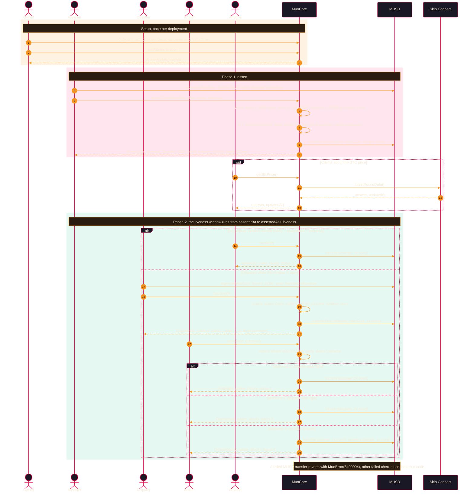

# Mezo Upbeat Oracle (MUO)

A permissionless **optimistic oracle** on [Mezo](https://mezo.org). Anyone can put a claim on-chain by locking a
**MUSD** bond. If nobody disputes it during the liveness window, it settles and the bond comes back. If someone does,
an allowlisted arbiter decides who wins the pot.

Price feeds such as Skip Connect and Pyth answer "what is the price?". MUO answers "is this statement true?", for
facts a contract cannot read itself: reserve audits, cross-chain state, event outcomes, parameter changes.

## Mezo-native implementation, deployed to testnet

The Mezo-native implementation is complete, gated locally, and deployed.

- **Local:** `bun --no-env-file run verify:local` passed as a single invocation — **17/17 steps, 670 aggregate checks, 0 failed** (642 workspace/contract plus 28 Node guard tests). All nine TypeScript configs pass; Biome reports 174 files with zero errors and warnings; both production webpack builds pass; the Workers minified runtime is 287.15 KiB / gzip 63.00 KiB.
- **Public:** the portal, landing site and API Worker are deployed on Mezo Testnet. Migration `0003_mezo_native_index` is applied to D1 `muo-testnet`.

The API now serves indexed chain data: **3 assertions** (1 open, 2 settled) built from 6 applied contract logs. `/v2/status` reports `"state":"ok"` with the cursor at the chain head. Scheduled indexing is **enabled** at `*/1 * * * *` (`triggers.crons` in `wrangler.jsonc`); each tick is one bounded cycle, capped by `maxBlocksPerRun`. Measured cost on catch-up ticks spanning the full 500 blocks was 9–11 ms CPU with `outcome: ok`, and steady state is ~15 blocks. A manual `POST /v2/indexer/run` remains available with `INDEXER_ADMIN_SECRET` for backfills.

Not yet proven: a real browser wallet extension against live Mezo, a populated index, and explorer source verification. See [the implementation record](docs/MEZO-NATIVE-MIGRATION.md) for exact gates and limits.

## Live on Mezo Testnet

| Item | Value |
|---|---|
| Contract | [`MuoCore` 0x61c41cD7299fD668c3a7aAE62F12c017fE654Cb0](https://explorer.test.mezo.org/address/0x61c41cD7299fD668c3a7aAE62F12c017fE654Cb0) |
| Network | Mezo Testnet, chain ID `31611`, RPC `https://rpc.test.mezo.org` |
| Bond token | MUSD `0x118917a40FAF1CD7a13dB0Ef56C86De7973Ac503` (18 decimals, EIP-2612 permit) |
| Price feed | Skip Connect `0x7b7c000000000000000000000000000000000015` |
| Deployment | block `16380473`, tx `0x54e2772177c370b1fe1608b88b5795fdce8cf0ae91453a59c583663c95b02916` |
| Build | Solidity `0.8.28`, `evmVersion: london`, optimizer 200 runs, 7,440 bytes runtime |
| Events so far | 3 `Asserted`, 1 `Disputed`, 2 `Settled`, 1 `ArbiterAdded` |
| Landing site | https://mezo-upbeat-oracle-site.vercel.app |
| Portal | https://mezo-upbeat-oracle.vercel.app |
| API | https://muo-api.k2jodz91zi.workers.dev ([health](https://muo-api.k2jodz91zi.workers.dev/health)) |
| Pitch deck | [MUO-Pitch-Deck.pdf](https://mezo-upbeat-oracle-site.vercel.app/MUO-Pitch-Deck.pdf) |

Mainnet (chain ID `31612`) uses MUSD `0xdD468A1DDc392dcdbEf6db6e34E89AA338F9F186`. MUO is not deployed there yet.

## How it works



Status codes: `0` Open, `1` Disputed, `2` Settled, `3` Rejected, `4` Unresolved.

The local portal uses the two-transaction approve-then-write flow. The contract also supports EIP-2612 permit methods, but the portal does not implement them or promise gasless signing. Wallet support is injected EIP-1193/EIP-6963, not Passport or WalletConnect.

Local browser acceptance has been proven at two levels. The first used a **fake injected provider** against a real Next production build, local Anvil contracts and a fixture API — an honest mixed proof. The second drove a **real, unmocked** Hono + SQLite/indexer API through the UI in two separate runs.

- **Resolve run** — assertion `0x021eabdd…74fd` reached terminal `settled`, escrow `20 → 0`.
- **Polling run** — a different assertion `0xe97ca1a9…5aac` on a different chain ended `disputed`, escrow `0 → 10 → 20`. It proved active-view polling: the row appeared 4780 ms and the status flipped 4943 ms after the write, with no reload and no manual refetch, served with `Cache-Control: no-store`.

An assertion id is **not** a transaction hash, and the two runs' escrow figures are not comparable — `20` is an intermediate disputed state, `0` is terminal. Neither is a browser extension, a live Mezo wallet, or a public deployment. The wallet remains an injected EIP-1193 provider, and the portal uses the two-transaction approve-then-write flow rather than permit.

## Contract interface (`contracts/muo/contracts/MuoCore.sol`)

| Function | Caller | Effect |
|---|---|---|
| `assertClaim(identifier, claim, bondMusd, liveness)` | anyone | Locks `bondMusd` MUSD (minimum 10). Claim is 1 to 2,048 bytes. `liveness = 0` uses 1,440 blocks |
| `assertWithPermit(..., deadline, v, r, s)` | anyone | EIP-2612 permit and `assertClaim` in one transaction |
| `dispute(id)` / `disputeWithPermit(id, ...)` | anyone except the asserter | Locks a matching bond while the window is open |
| `settle(id)` | anyone | Returns the bond once the window has closed with no dispute |
| `resolve(id, status)` | arbiter that is not a party | Picks the outcome of a disputed assertion |
| `addArbiter(account)` / `removeArbiter(account)` | owner | Edits the arbiter allowlist (the deployer starts as arbiter) |
| `getAssertion`, `isArbiter`, `isWindowOpen`, `isWindowClosed`, `deriveAssertionId` | view | State reads and the ID derivation |
| `getBtcPrice()` | view | `(answer, updatedAt)` from the Skip Connect BTC/USD feed |
| `getDefaultLiveness`, `getMinBondMusd`, `getMinBondSats` | view | Protocol constants |

Failures revert with `MuoError(code)`. Codes run from `8400001` (window open) to `8500000` (serialization failed).

## Repository layout

| Path | What it is |
|---|---|
| `contracts/muo` | `MuoCore.sol` |
| `packages/core` | Shared schemas and constants |
| `packages/utils` | Assertion-ID helper, status and error tables, UI primitives |
| `packages/sdk` | Native compiler-ABI EVM assertion-log decoder; no Stacks runtime |
| `packages/api` | Hono on Cloudflare Workers with D1; native `/v2/assertions`, bounded RPC indexer and atomic ledger/projection/cursor; legacy rows remain read-only |
| `packages/event-listener` | Native authenticated manual sync controller; scheduled ingestion remains disabled pending CPU measurement |
| `packages/integration` | Local Anvil contract/SDK interoperability tests, not live Mezo evidence |
| `packages/app` | Next.js verification portal |
| `packages/www` | Next.js landing site |

## Quick start

```bash
bun --no-env-file install --ignore-scripts
bun --no-env-file run test                          # workspace test scripts and artifact guards
bun --no-env-file run verify:local                  # full local gate (see below)
bun --no-env-file run --filter @muo/api dev          # API on :8787
bun --no-env-file run --filter @muo/app dev          # portal on :3000
```

The root `test` script runs `scripts/test-workspaces.mjs`, which executes each workspace suite serially, disables Bun environment autoload, and fails on any non-zero child exit or missing test script rather than silently skipping a package. It then runs the Node guard tests.

### `verify:local` — one-command local gate

`bun --no-env-file run verify:local` runs the full local verification serially, in this order:

1. a frozen-install preflight (`--frozen-lockfile --ignore-scripts`) — cheap, and a stale lock invalidates everything downstream,
2. the workspace suites,
3. the Node guard tests, exactly once,
4. all nine TypeScript configs, one at a time,
5. Biome over the repo,
6. the Workers minified runtime smoke test,
7. the app and landing-site production builds, one at a time,
8. `bun audit --json` (a registry advisory check, **not** a security guarantee).

It also verifies the protected artifacts before running anything: the `MuoCore.sol`, `theme/theme.css` and generated-ABI hashes, plus the 64-entry ABI shape (55 functions, 7 events, 1 error, 1 constructor).

Every step has a bounded timeout. A spawn error, a signal, a timeout or a missing exit status is a **failure**, never a pass, and the run stops at the first failing step with its name. There is no partial mode: a partial run is never reported as a pass. Use `--list` to print the plan without executing it.

It performs no deploy, publish, upload, Git mutation, secret read or public-chain transaction.

Deploy `MuoCore` with any Solidity 0.8.28 toolchain, `evmVersion: london`, and the MUSD address as the constructor
argument (`address(0)` selects the testnet MUSD). Copy each `.env.example` before running a package.

## Status and next steps

- **Public baseline:** the contract, API and portal interface were deployed before this local migration. Those public deployments are unchanged and are not native wallet-to-indexer demos.
- **Local state:** complete and recorded. `verify:local` passed as a single invocation — 17/17 steps, 662 aggregate checks, 0 failures. Per-suite counts: contracts 75, API 192, app 240, core 26, event-listener 12, integration 38, SDK 42, utils 9, plus 28 Node guard tests. Evidence and the machine-readable summary are in `outputs/continuation-20261028/verification/`.
- **Deliberately disabled:** scheduled ingestion. A bounded authenticated manual sync controller is required until an operator approves and measures Workers CPU. This is not automatic production indexing.
- **Remaining risks:** no real wallet extension or live Mezo cycle has been exercised; deep reorgs beyond 128 blocks halt for operator action; the historical Vercel secret archive question is unresolved; the deployed bytecode is not source-verified on the explorer.
- **Releasing** requires reviewed Git source, a redacted Gitleaks artifact, a fresh public-environment build, and explicit approval per action. See [ARTIFACT-STAGING.md](docs/ARTIFACT-STAGING.md). No mainnet readiness is claimed.
- **Deploying the API yourself:** create your own D1 database and put its id in `packages/api/wrangler.jsonc`.

## License

[MIT](./LICENSE)
